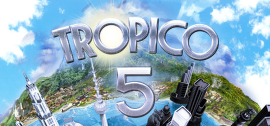

**Tropico 5 is the satirical city-builder where you play El Presidente ruling a banana republic through multiple historical eras. Features dynasty mechanics where your descendants inherit power and a multiplayer mode for competing or cooperating on islands.**

---

## 📖 About

Tropico 5 is the satirical city-builder where you play El Presidente ruling a banana republic through multiple historical eras. Features dynasty mechanics where your descendants inherit power and a multiplayer mode for competing or cooperating on islands.

## ⚠️ Problems Without Trainer

| Problem | Status |
|---------|--------|
| **Faction Balance** — Satisfying all political factions simultaneously requires constant management | ✅ Solved |
| **Era Transitions** — Each historical era dramatically changes available buildings and conditions | ✅ Solved |
| **Mission Requirements** — Specific sandbox mission objectives require setting up production chains far in advance | ✅ Solved |
| **Import Export Timing** — Setting up profitable trade routes requires understanding production delays | ✅ Solved |

## ✅ Solution

The **Tropico 5 Trainer** solves all these issues by giving you complete control over the game.

## 🎯 Full Feature List

- Unlimited Resources
- God Mode / Invincibility
- Instant Skill Cooldown
- One-Hit Kill
- Freeze Game Timer
- Unlock All Items & Achievements
- Custom Speed Multiplier
- Save State Anywhere

## 🚀 Quick Start

1. **Disable Windows Defender** temporarily (trainer may trigger false positive)
2. Download the trainer from the button above
3. Launch Tropico 5
4. Run the trainer as Administrator
5. Activate desired cheats with hotkeys

## 💎 Free vs Paid

| Feature | Free | Pro |
|---------|------|-----|
| Basic God Mode | ✅ | ✅ |
| Unlimited Resources | ✅ | ✅ |
| All Advanced Cheats | ❌ | ✅ |
| Auto-Updates | ❌ | ✅ |
| Priority Support | ❌ | ✅ |

## 💻 Requirements

- Windows 10/11 (64-bit)
- Tropico 5 (any version)
- .NET Framework 4.8+
- DirectX 11+

## 🍎 macOS

macOS users can use our alternative tool:

## ⚖️ Legal

This trainer is for educational and single-player use only. Use responsibly.

---

